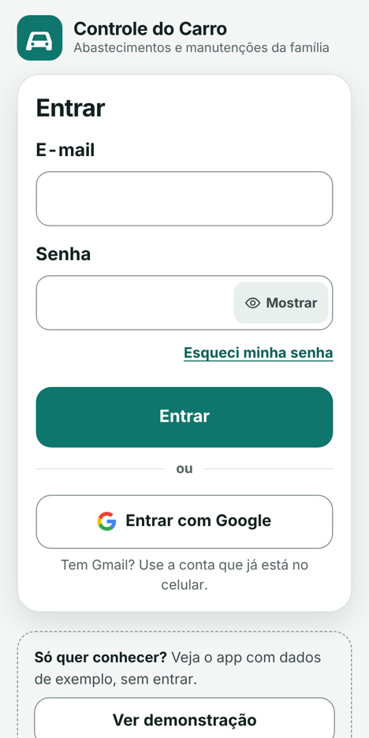
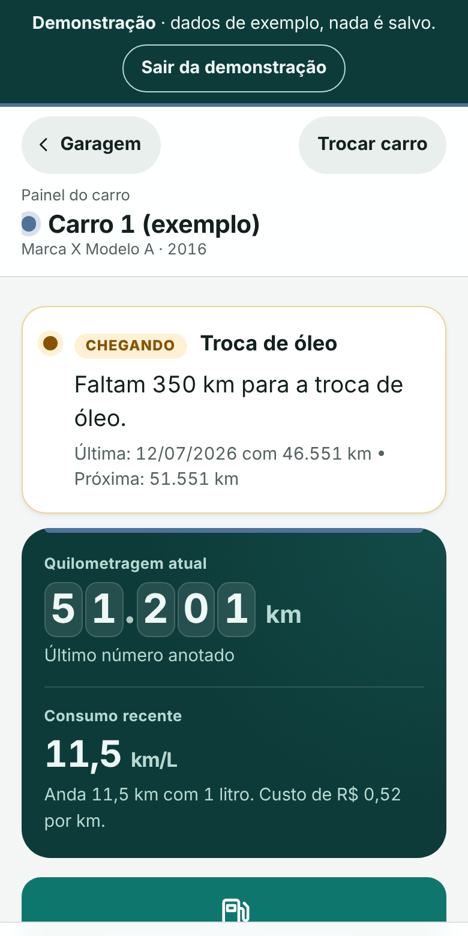
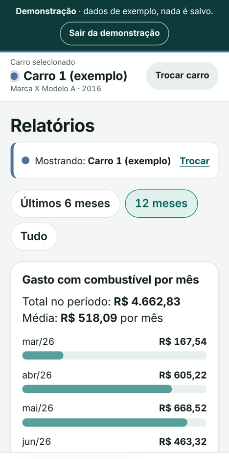

# 🚗 Controle do Carro

Aplicativo para a minha família anotar os abastecimentos e as manutenções de um ou mais carros. Foi feito pensando nos meus pais, que não têm muita familiaridade com tecnologia: botões grandes, poucos campos, tudo em português do Brasil, e os mesmos dados no celular de cada um.

**▶ [Abrir o app](https://controlecarro.web.app)**: publicado no Firebase Hosting, com um projeto Firebase próprio no plano gratuito. O acesso exige login com um e-mail autorizado pela família. Para conhecer sem login, use o botão **Ver demonstração** na tela de entrada, que mostra o app com dados fictícios.

| Entrada | Painel do carro | Relatórios |
|---|---|---|
|  |  |  |
| Login com Google ou e-mail e senha | Avisos de manutenção e os números do carro | Gasto e consumo mês a mês |

Imagens do modo demonstração, com dados fictícios.

## Por que existe

Com um ou mais carros em casa, é difícil lembrar de cabeça quanto se abasteceu, se o carro está gastando mais do que antes, quanto foi gasto no mês e quando chega a próxima troca de óleo. Meus pais precisavam de um jeito simples de anotar isso cada um no seu celular, sem misturar os dados de um carro com os do outro.

## O que a família consegue fazer

- **Anotar abastecimentos** com a quilometragem do painel, os litros e o valor da nota. O app calcula o preço por litro, quanto o carro andou, o consumo em km por litro, o custo por km e quanto o litro subiu ou baixou.
- **Registrar manutenções** e receber avisos. A troca de óleo é lembrada a cada 5.000 km (o intervalo pode ser mudado). Pneus e outros serviços avisam por km ou por data, quando a pessoa quiser. Os avisos são frases simples, como “Faltam 500 km para a troca de óleo”.
- **Começar pela Garagem**, com um cartão para cada carro (nome, marca, modelo, ano, quilometragem e próximo aviso); tocando no carro, abre o painel dele.
- **Ver o painel** de cada carro com a quilometragem atual, o consumo recente, o gasto do mês, o último abastecimento e a próxima manutenção.
- **Consultar o histórico** por período, e corrigir ou apagar registros, sempre com confirmação.
- **Ver relatórios** de gasto com combustível por mês e de consumo ao longo do tempo.
- **Acompanhar um ou mais carros, separados:** cada um tem seus próprios registros, cálculos, lembretes e uma cor própria na tela. A família começa sem nenhum carro, cadastra o primeiro e adiciona outros quando precisar.
- **Arquivar um carro** que não é mais usado: ele sai da lista, mas todos os registros continuam guardados e podem ser consultados em modo somente leitura ou reativados.
- **Ajustar a aparência:** texto em três tamanhos e tema claro, escuro ou automático. A escolha acompanha a conta da pessoa em qualquer celular.
- **Guardar uma cópia** dos dados em arquivo e exportar uma planilha para Excel ou Google Planilhas.

## Em vários celulares

Cada pessoa entra com a conta Google ou com e-mail e senha. Só entram os e-mails que a família autorizou, numa tela do próprio app. Depois disso todos veem os mesmos carros e registros, e o que um anota aparece no celular do outro. Sem internet, dá para continuar anotando: os registros ficam guardados no aparelho e são enviados quando a conexão volta.

**Estado atual:** o site está publicado e ligado ao projeto Firebase da família. No projeto real foi conferido que a tela de entrada carrega, que os logins por Google e por e-mail e senha estão ativos e que o banco recusa acesso sem login. O fluxo completo com contas reais (criar a família, sincronizar entre celulares, regras de acesso por e-mail) foi testado nos **emuladores** do Firebase e ainda não foi verificado no projeto real.

## Decisões técnicas

**Consumo pelo tanque cheio.** O consumo é a distância entre dois abastecimentos com tanque cheio dividida pelos litros colocados para completar o tanque. Por isso o formulário pergunta “Encheu o tanque até o fim?”. Quando o tanque não é completado, os litros entram na conta do próximo tanque cheio. Quando falta dado para calcular, o app explica o motivo em vez de mostrar um número confuso.

**Validação antes de salvar, em linguagem simples.** A quilometragem não pode ser menor que a do registro anterior, e litros e valor precisam ser maiores que zero. Valores estranhos, como um preço por litro fora do normal, mostram um aviso e deixam a pessoa corrigir ou salvar assim mesmo.

**Cada registro sabe de qual carro é.** Todo abastecimento e manutenção guarda o carro a que pertence, e cálculos, histórico, relatórios e lembretes são sempre filtrados por ele. Nas telas de anotar, o nome e a cor do carro ficam em destaque para evitar registrar no carro errado.

**Acesso negado por padrão.** As regras do Firestore ([`firestore.rules`](firestore.rules)) só liberam quem fez login, confirmou o e-mail e está na lista de e-mails da família, e conferem o formato dos dados gravados. Elas têm testes automáticos no emulador.

**Visual de painel de bordo, sem logotipos de terceiros.** Odômetro, quadro de instrumentos e luzes de aviso inspiram a identidade. A marca de cada carro aparece num selo próprio, com a sigla (VW, FIAT…), em vez de logotipos registrados. Ícones e ilustração foram desenhados para o app e tudo funciona sem internet.

**Preferências separadas dos dados.** Tema e tamanho do texto ficam num perfil de cada pessoa, que só ela lê e grava. Esse perfil não dá acesso a nenhuma família.

**Configuração fora do Git.** O repositório tem só código e documentação. A configuração do Firebase fica num arquivo ignorado pelo Git ou num segredo do GitHub, e nenhuma credencial administrativa é usada.

**Sem framework.** HTML, CSS e JavaScript puros, sem etapa de build. O modo demonstração usa as mesmas telas, com dados só na memória do aparelho.

## Tecnologias

- HTML, CSS e JavaScript, sem framework
- **Firebase Authentication** (Google e e-mail/senha) e **Cloud Firestore**, com cache no aparelho para funcionar sem internet
- **GitHub Actions** para testes e publicação no **Firebase Hosting**
- Testes com **Node**, **Firebase Emulator Suite** e **`@firebase/rules-unit-testing`**

## Documentação

- [Guia de uso no celular](COMO-USAR.md): passo a passo para quem vai anotar.
- [Configuração e publicação](docs/CONFIGURAR-FIREBASE.md): criar o projeto Firebase, cadastrar as pessoas, migrar dados antigos e publicar.
- [Desenvolvimento e testes](docs/DESENVOLVIMENTO.md): rodar no computador, testes, estrutura do código e dos dados, e fórmulas.

---

Projeto de [Erick Abe](https://github.com/erickabee), idealizado para a família e desenvolvido com o auxílio do Claude (IA da Anthropic).

Distribuído sob a licença [MIT](LICENSE).
